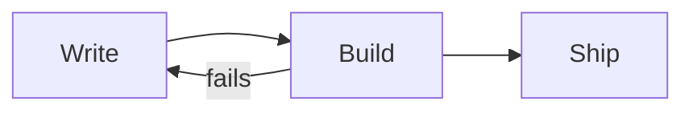

# Hello

## Starlight

import { FileTree } from "@astrojs/starlight/components";

<FileTree>

- astro.config.mjs
- package.json
- src
  - components
    - Header.astro
    - Title.astro
  - pages/

</FileTree>

## Markdown

| A   |  B  |   C |
| --- | :-: | --: |
| a   |  b  |   c |

### Mathematics

Inline $w=4$.

$$
x=1
y=2
z=3
$$

### 

*[abbr]: abbreviation

abbr

~~delete~~

++insert++

==mark==

> [!NOTE]
> Useful information that users should know, even if skimming.

> [!TIP]
> Helpful advice for getting things done more effectively.

> [!WARNING]
> Urgent info that needs immediate user attention to avoid problems.

> [!CAUTION]
> Advises about risks or negative outcomes of certain actions.

