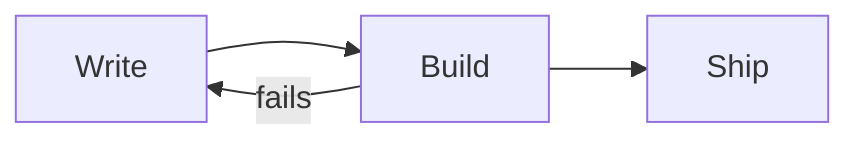

# Hello

## Starlight

import { FileTree } from "@astrojs/starlight/components";

<FileTree>

- astro.config.mjs
- package.json
- src
  - components
    - Header.astro
    - Title.astro
  - pages/

</FileTree>

## Markdown

| A |  B  |  C |
|---|:---:|---:|
| a |  b  |  c |

### Mathematics

Inline $w=4$.

$$
x=1
y=2
z=3
$$

### 

*[abbr]: abbreviation

abbr

~~delete~~

++insert++

==mark==

> [!NOTE]
> Useful information that users should know, even if skimming.

> [!NOTE] Opmerking
> Useful information that users should know, even if skimming.

> [!TIP]
> Helpful advice for getting things done more effectively.

> [!WARNING]
> Urgent info that needs immediate user attention to avoid problems.

> [!WARNING] Waarschuwing
> Urgent info that needs immediate user attention to avoid problems.

> [!CAUTION]
> Advises about risks or negative outcomes of certain actions.

> [!CAUTION] Opgelet
> Advises about risks or negative outcomes of certain actions.





Here is a footnote[^1] with some additional text after it.

[^1]: My reference.

## Code

https://expressive-code.com/key-features/text-markers/

import { Code } from '@astrojs/starlight/components';
import importedCode from '@/code/test.jsx?raw';

<Code code={importedCode} lang="jsx" title="test.json" mark={{label: "1", range: "4"}} del={{label: "2", range: "6-7"}} ins={{label: "3", range: "9-11"}} />

```jsx title="test.json" {"1":4} del={"2":6-7} ins={"3":9-11}
<button
  role="button"
  {...props}
  value={value}
  className={buttonClassName}
  disabled={disabled}
  active={active}
>
  {children &&
    !active &&
    (typeof children === "string" ? <span>{children}</span> : children)}
</button>;
```


``` frame="txt"
PS>
```

import { Kbd } from 'starlight-kbd/components';

<Kbd mac="Command+S" windows="Control+S" />

## Emoji

[Emojibase Emoji table (GitHub)](https://emojibase.dev/emojis?shortcodePresets=github)

| code           |                      |                     |                        |                        |               |
|----------------|----------------------|---------------------|------------------------|------------------------|---------------|
| :heart:        | :red_square:         | :red_circle:        | &nbsp;                 | &nbsp;                 | :closed_book: |
| :orange_heart: | :orange_square:      | :orange_circle:     | :small_orange_diamond: | :large_orange_diamond: | :orange_book: |
| :yellow_heart: | :yellow_square:      | :yellow_circle:     | &nbsp;                 | &nbsp;                 | &nbsp;        |
| :green_heart:  | :green_square:       | :green_circle:      | &nbsp;                 | &nbsp;                 | :green_book:  |
| :blue_heart:   | :blue_square:        | :large_blue_circle: | :small_blue_diamond:   | :large_blue_diamond:   | :blue_book:   |
| :purple_heart: | :purple_square:      | :purple_circle:     | &nbsp;                 | &nbsp;                 | &nbsp;        |
| :brown_heart:  | :brown_square:       | :brown_circle:      | &nbsp;                 | &nbsp;                 | &nbsp;        |
| :black_heart:  | :black_large_square: | :black_circle:      | &nbsp;                 | &nbsp;                 | &nbsp;        |
| :white_heart:  | :white_large_square: | :white_circle:      | &nbsp;                 | &nbsp;                 | &nbsp;        |

| Country        |     Flag      | Shortcode (GitHub) |
|:---------------|:-------------:|:-------------------|
| Belgium        |   :belgium:   | `:belgium:`        |
| France         |     :fr:      | `:fr:`             |
| Germany        |     :de:      | `:de:`             |
| Ireland        |   :ireland:   | `:ireland:`        |
| United Kingdom |     :uk:      | `:uk:`             |
| United States  | :netherlands: | `:netherlands:`    |
